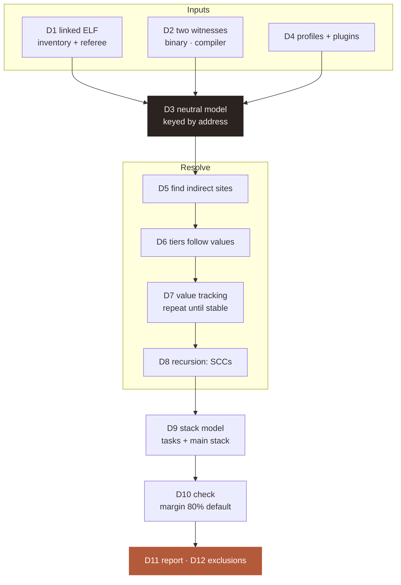
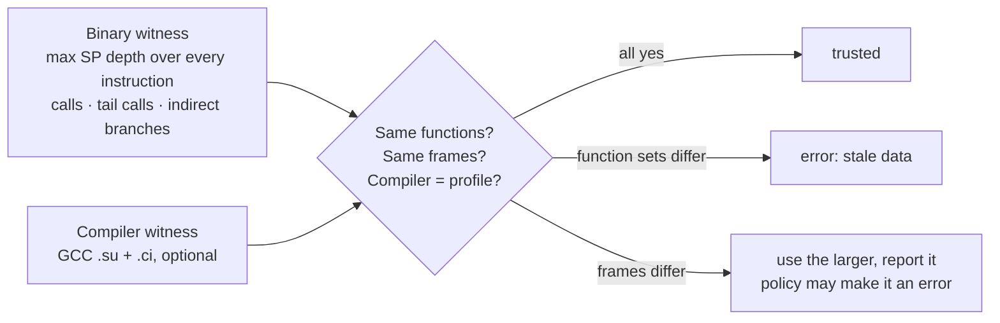
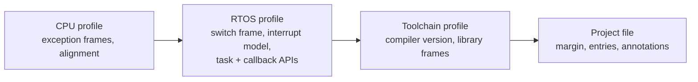
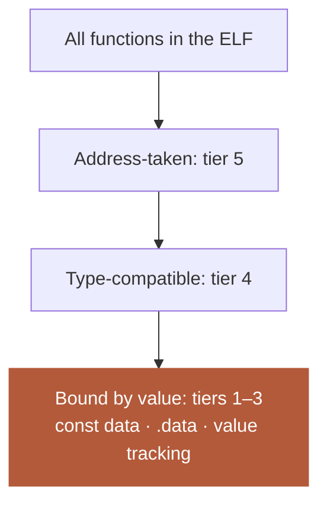
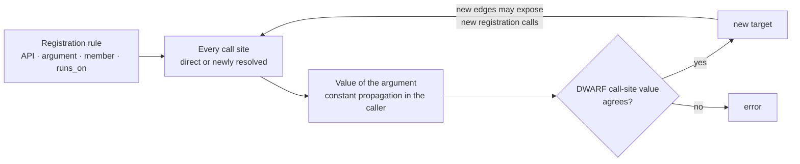
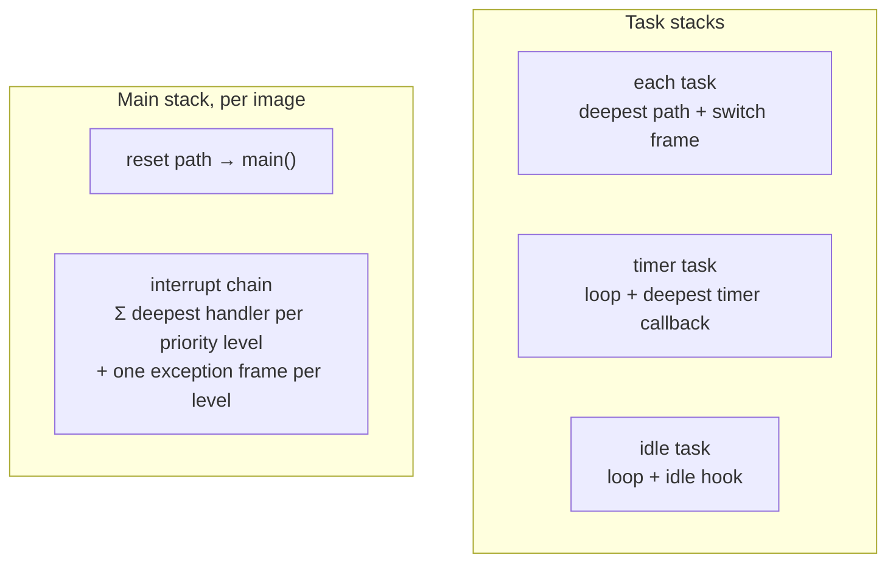
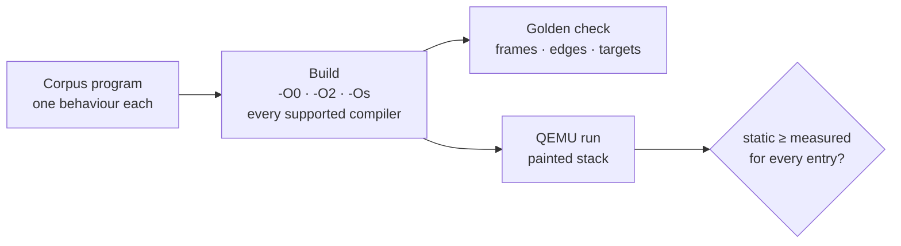
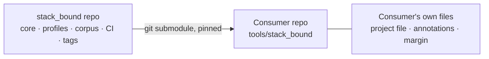

# ADR-0001: stack_bound architecture

**Status:** accepted · 2026-11-10 · reviewed by the owner ([review record](../review/2026-11-10-ADR-0001.md)) · requirements [REQ-SB-001…504](../requirements/stack_bound.md) · idea [idea.md](../idea.md)

**Summary.** The linked ELF is the referee, and two witnesses (the binary and the compiler) must agree.
Function pointers are resolved by following values, and each stack is checked against a margin rule
(default 80%). Fifteen decisions (D1–D15) fix the design. Each one traces to requirements and tests.

## 1. Context

**Table 1.** What forces the design.

| Fact | Consequence for the design |
|---|---|
| High-water marks only see paths that ran (W40: 768 B stack, 856 B worst case) | Bound every path statically |
| GCC's call graph alone gave **552 B** for a **1256 B** path: the deepest frame sat behind a function pointer | Function pointers can never be dropped silently |
| Embedded code is full of callbacks, interrupt handlers installed at runtime, timers, driver tables | Function-pointer resolution is the core feature, not an add-on |
| Compilers, CPUs and RTOSes vary | Platform facts are data; the core stays neutral |
| Development builds always carry symbols and DWARF | Require them; no degraded mode |

## 2. Decisions at a glance



**Figure 1.** Where each decision sits in the pipeline. D13 (implementation), D14 (validation) and D15
(repository) frame the whole tool.

## 3. Decisions

### D1. The linked ELF is the inventory and the referee

Every `STT_FUNC` symbol is a function. A function on an analysed path with no frame from any witness
is an **error, never 0 B**. The ELF must be unstripped and carry DWARF; otherwise the tool refuses.
The ELF is read directly, with no `objdump`.

*Rejected:* compiler output as the inventory (misses LTO, assembly and libraries without noticing);
a no-DWARF mode (no real user, more ways to be silently wrong).

### D2. Two witnesses, cross-checked



**Figure 2.** The cross-check. A register-loaded SP fails unless a profile gives that frame. A tail call
counts `max(caller, callee)`, not the sum. Real examples:
[How it reads Thumb-2](../how-it-reads-thumb2.md) §1.

*Rejected:* compiler data with disassembly only as a fallback (one source can be stale unnoticed);
binary only (loses the compiler's exact view and its record of indirect calls).

### D3. One neutral model, functions keyed by address

**Table 2.** The model (a versioned JSON schema any toolchain can feed).

| Entity | Key | Holds |
|---|---|---|
| function | ELF address, Thumb bit cleared | size, DWARF file/line/column, frame per witness |
| edge | caller, callee | kind (call, tail call, indirect) + provenance (witness, tier) |
| site | function + instruction address | an indirect call waiting for targets |
| stack | entry point | configured size, its source |
| unknown | the thing not seen | why it blocks the result |

Compiler data joins on **(file, line, column, name)** from DWARF, so same-name statics and GCC clones
(`.constprop.N`, `.isra.N`) map exactly. *Rejected:* keying by name.

### D4. Profiles hold facts, plugins hold logic



**Figure 3.** Profile layers (TOML, numbers and names only); later layers override, and the report shows
which layer set each value. Unknown keys are errors. Frontends, decoders, resolvers and reporters are
plugins found through Python entry points, built-ins included.

*Rejected:* a Python config (can't be reviewed as data); hard-coded platform tables.

### D5. Every indirect call site is found by both witnesses

**Table 3.** How a write to `pc` is classified.

| Instruction pattern | Classified as |
|---|---|
| `blx rN`, `bx rN` (not `lr`), `ldr pc, …` / `mov pc, …` outside the patterns below | **indirect site** `(function, address)` |
| `cmp` + `bhi` + `tbb`/`tbh [pc, rN]` or a `ldr pc, [pc, rN, lsl #2]` table | switch inside the function |
| `ldr pc, [sp], …` / `pop {…, pc}` after a prologue that pushed `lr` | return |

A site the binary finds but the compiler witness doesn't report is an error.

### D6. Function-pointer targets come from tiers that follow values; types only filter



**Figure 4.** The funnel. Tiers 1–3 follow values, so `void *` casts don't break them.

**Table 4.** The tiers.

| Tier | Source |
|---|---|
| 1 Const data | `.rodata`: a struct member over every instance of its DWARF type, arrays, vtables |
| 2 Initialised data | `.data` initial values stored in the ELF |
| 3 Value tracking | registration and store sites (D7) |
| 4 Type match | DWARF prototype over the address-taken set |
| 5 Address-taken | data words, literal-pool loads, `movw/movt`, `adr` |
| Listed | annotation, checked against tier 5 and the type |

- Annotations name a **rule** (`binding = "ipc_port_if_t.transact"`), not a list, wherever possible.
- Type never removes a target found by tiers 1–3. A prototype mismatch is reported as a **type-punned call**.
- A listed target that isn't address-taken or isn't type-compatible is an error. A plausible missing one is a warning.
- Project policy `max_fallback` sets the lowest tier allowed. Every edge carries its tier.

*Rejected:* types first (breaks on casts); manual lists only (go stale); points-to analysis (heavy).

### D7. Value tracking: registration and store sites, repeated until nothing changes



**Figure 5.** The loop runs until an iteration adds nothing. It terminates because targets come from a
finite set.

```toml
[[register]]
api = "Cy_SysInt_Init"
param = 2
runs_on = "isr"        # self · a named task (timer) · isr
```

Constant propagation covers `ldr =`, `adr`, `movw/movt` and constant `add`/`sub`. Values passed straight
through from an argument are followed into callers, up to a set depth. A struct-member argument is found
on the stack (`add rN, sp, #k`), in a global, or in const data. `binding = "var:s_cb"` tracks stores.
`runs_on` decides the stack the callee is charged to (D9). RTOS and HAL profiles ship the standard rules.

### D8. Recursion: strongly connected components, depth by annotation

Cycles are found after resolution (Tarjan). An unannotated cycle is an error listing its edges with
provenance, so a cycle created only by a tier-4/5 edge shows as such.

```text
cost = max_depth × most_expensive_simple_cycle (Johnson) + most_expensive_exit
       above the SCC size cap: max_depth × sum_of_frames  (labelled over-estimate)
```

### D9. The stack model: task stacks and one main stack per core



**Figure 6.** What is analysed. Tasks come from task-creation calls (D7); the vector table and `isr`
registrations give the handlers; linker symbols give the main stack's size.

**Table 5.** The RTOS profile's interrupt model sets the main-stack combination.

| Interrupt model | Main stack required |
|---|---|
| Separate stack, interrupts masked until the scheduler starts (FreeRTOS on Cortex-M) | `max(pre-scheduler path, interrupt chain)` |
| Separate stack, interrupts possible before the scheduler | `pre-scheduler path + interrupt chain` |
| Shared: interrupts run on the task's stack | chain added to **every task** |

An unknown priority gets its own level (safe). Multi-core parts are analysed one image at a time.

### D10. The check: a margin rule, a recommended size, oversized stacks

```text
pass        if  required ≤ margin_rule × configured      margin_rule default 0.80, per project
recommended =   ⌈required / margin_rule⌉ rounded up to the profile's alignment (also in words)
OVERSIZED   if  margin > oversized_above                  warning, not failure
```

### D11. The report

**Table 6.** Report contents and exit codes.

| Part | Content |
|---|---|
| Per stack | required · configured · margin · recommended · status · worst path with frames and edge provenance |
| Assumptions | every annotation, exclusion and profile value, with its layer |
| Formats | text · JSON (versioned schema, also the baseline) · SARIF |
| Diff | per-stack change and the changed path, against a baseline JSON |
| Reproducibility | ELF SHA-256 · tool version · profile names and versions |
| Exit codes | `0` pass · `1` check failed · `2` analysis error · `3` usage error |

### D12. Exclusions for paths that can't run together

An optional annotation lists path pairs that never occur together, each with a reason. The walk never
combines them, and the report lists each one. The tool doesn't try to prove them.

### D13. Implementation

**Table 7.** Building blocks.

| Need | Choice | Rejected |
|---|---|---|
| ELF + DWARF | `pyelftools` | parsing `readelf` text |
| Instructions | `capstone` (structured, many ISAs) | parsing `objdump -d` text (varies by version and vendor) |
| Profiles | `tomllib` (standard library) | YAML (extra dependency) |
| Compiler output | real parsers, strict, chosen by compiler version | regular expressions |
| Tests | `pytest` | — |

Python 3.11+.

### D14. Validation: a corpus with golden results and measured stacks



**Figure 7.** Two checks per program. Behaviours: const struct, dispatch array, callback argument,
returned pointer, runtime registration, `void *` cast, indirect tail call, pointer to a `static`
function, stack struct then registered, recursion, `switch` table, inline asm, virtual methods,
`std::function`.

### D15. Its own repository, used as a submodule



**Figure 8.** The tool holds no consumer content. It runs as `python -m stack_bound`, installed or with
`src/` on `PYTHONPATH`.

*Rejected:* `pip install` from a tag (not in `tools/`, awkward to edit); a plain clone (no pinned version).

## 4. Consequences

**Table 8.** What this design buys and costs.

| | Consequence |
|---|---|
| + | Every number comes with its path and its assumptions; nothing is dropped silently |
| + | Function pointers become the strongest part: bindings follow values and are checked against the binary |
| + | Compiler-independent (binary witness), precise where the compiler helps; changing options is safe |
| + | New platforms are data first, plugins second; the core doesn't change |
| − | More to build than a script: ELF/DWARF reader, decoder, value tracking, QEMU corpus |
| − | Wrong profiles give wrong bounds, so profiles cite their source |
| − | Over-estimates paths that never run together, unless excluded |
| − | Strict: new sites, cycles and unknown functions fail until handled (intended) |

## 5. Alternatives considered

**Table 9.** Overall approaches.

| Option | Why not |
|---|---|
| GCC-only script (`.su` + `.ci`) | One compiler; drops indirect calls; blind to assembly and LTO gaps |
| Disassembly only | No second witness; loses the compiler's record of indirect calls |
| Extend `avstack.pl` / puncover | Silent drops are built into their design |
| AbsInt StackAnalyzer | Stronger on feasibility, but licensed and closed; named in the docs as the industrial answer |
| Runtime measurement only | Sees only paths that ran; kept as the cross-check (D14) and last line of defence |

## 6. Spike: GCC 14.2.1 output

**Table 10.** Questions checked on traveo-body-domain Node B (`proj_cm7`, `-g -Og`, DWARF 5) on
2026-11-10. Six files were recompiled with the project's flags plus `-fstack-usage
-fcallgraph-info=su`, into a scratch folder.

| Question | Result | Consequence |
|---|---|---|
| `.ci` edges carry the call-site location? | **Yes**, every edge incl. each `__indirect_call`: `secoc_rx.c:90:55` | Indirect sites are known **per call** (D5) |
| `static` functions in `.ci`? | `title: "<file>:<name>"`; externals by bare name | Same-name statics already separated |
| `.su` matches DWARF? | **Exactly**: `secoc_rx.c:68:20` = decl line 68, column 20 | Join key (file, line, column, name) (D3) |
| DWARF call-site values? | **Yes**: 57 in `can_task.c`, 40 in `secoc_rx.c` | Second witness for D7 is real |
| Tasks from DWARF alone? | **Yes**: entry address (+ Thumb bit), `384` words, buffer and TCB | Task discovery needs no list (D9) |

## 7. Open items

**Table 11.** Open after acceptance.

| Item | Next step |
|---|---|
| Spike only at `-Og` | Repeat at `-O2`/`-Os` in the corpus; count surviving call-site values |
| Model and report schemas | Decide both (versioned) before the first plugin |
| Coverage gates | None yet: add an area's prefix to `[tool.trace_report] gates` as it is implemented |
| traveo ADR-0025 | Shrinks to the project's choices: profiles, margin, build-script gate, `LOG_EVT_TASK_STACK` |

**Related:** [idea](../idea.md) · [How it reads Thumb-2](../how-it-reads-thumb2.md) ·
[requirements](../requirements/stack_bound.md) · [style guide](../style-guide.md)
