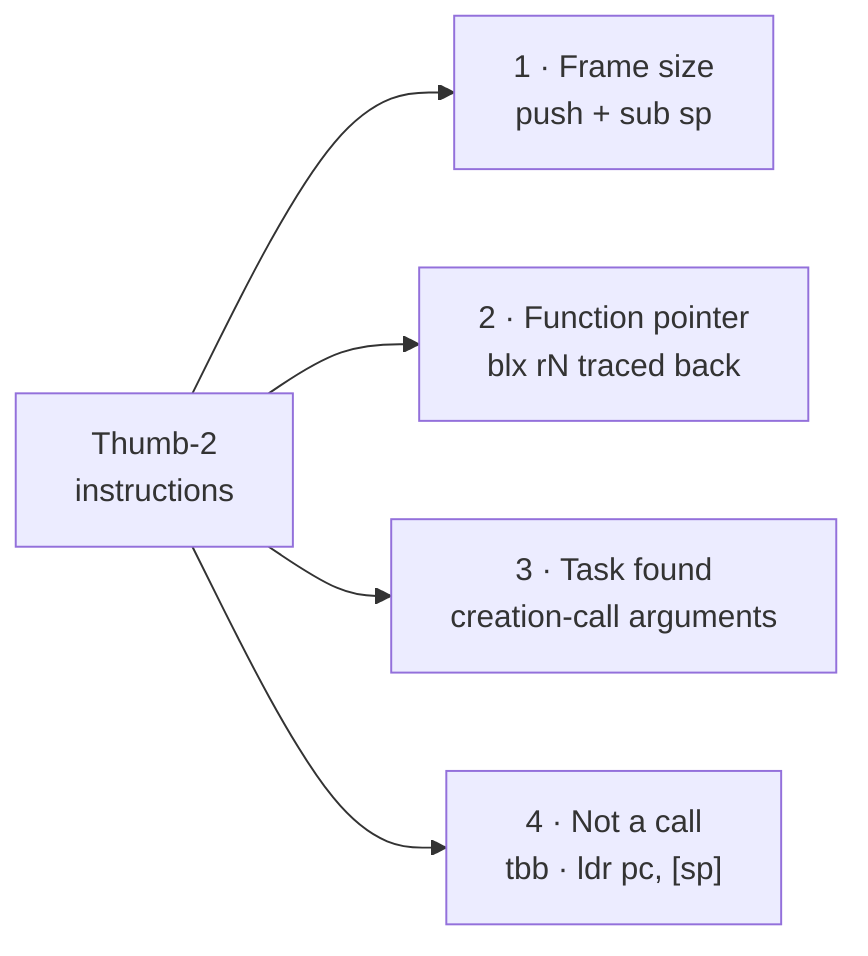
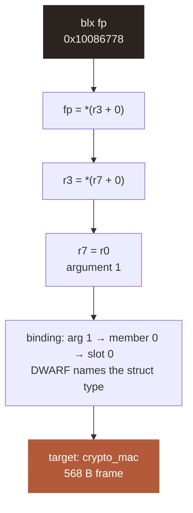
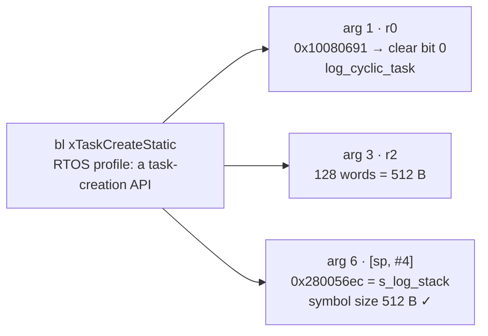

# How stack_bound reads Thumb-2

**Status:** reference · 2026-11-10 · examples from a real build

**Summary.** Four real Thumb-2 sequences show what the binary witness learns: a frame size, a
function pointer traced to its source, a task found from its creation call, and two writes to `pc`
that aren't calls. Every address comes from traveo-body-domain Node B (`actuator_cm7.elf`, Cortex-M7,
MTB GCC 14.2.1, `-Og`), disassembled with `arm-none-eabi-objdump -d`.



**Figure 1.** The four things the binary witness reads from instructions.

## 1. Frame size: `verify_core`

```armasm
10086742  stmdb  sp!, {r4, r5, r6, r7, r8, r9, sl, fp, lr}
10086746  sub    sp, #100
10086766  bl     1008668c <build_mac_input>
```

**Table 1.** Reading the prologue.

| Step | Instruction | What the tool learns |
|---|---|---|
| 1 | `stmdb sp!, {…}`: 9 registers × 4 B | SP depth **36 B** |
| 2 | `sub sp, #100`: locals (MAC buffers) | SP depth **136 B**, the frame |
| 3 | `bl build_mac_input`: target in the instruction | direct edge, certain |
| 4 | GCC `.su`: `verify_core 136 static` | binary = compiler ✓ |

The same rule gives `secoc_rx_process` 7 × 4 + 36 = **64 B**, again equal to GCC's `.su`.

## 2. Function pointer: `blx fp` in `verify_core`

```armasm
10086748  mov    r7, r0          @ r7 = argument 1
1008676c  ldr    r3, [r7, #0]    @ r3 = member at offset 0
1008676e  ldr.w  fp, [r3]        @ fp = first function slot
10086776  ldr    r0, [r7, #4]
10086778  blx    fp              @ indirect call
```



**Figure 2.** Tracing the pointer backwards, from the call to a struct member the binding rule can
resolve.

**Table 2.** What each witness contributes.

| Witness | Finds |
|---|---|
| Binary | the site `verify_core @ 0x10086778` and the register chain above |
| Compiler | `.ci` edge `verify_core → __indirect_call` labelled `secoc.c:139:10` |
| DWARF line table | `0x10086778 → secoc.c:139` ties the two together ✓ |

Without this step the walk stops at `blx fp` and reports **552 B**. With it, the walk continues
into `crypto_mac` and finds **1256 B**.

## 3. Finding a task: `log_task_create`

```armasm
100806c0  ldr    r3, [pc, #52]   @ → 100806f8: 0x280058ec  s_log_tcb
100806c2  str    r3, [sp, #8]    @ arg 7: TCB
100806c4  ldr    r3, [pc, #52]   @ → 100806fc: 0x280056ec  s_log_stack
100806c6  str    r3, [sp, #4]    @ arg 6: stack buffer
100806ce  movs   r2, #128        @ arg 3: depth in words
100806d2  ldr    r0, [pc, #48]   @ → 10080704: 0x10080691  entry | Thumb bit
100806d4  bl     10082ae0 <xTaskCreateStatic>
```



**Figure 3.** One call gives the entry, the configured depth and the buffer. The buffer's symbol size
confirms the depth.

DWARF records the same call-site values (`DW_TAG_call_site_parameter`: the entry address and
`128`), so the second witness agrees. No hand-written task list is needed.

## 4. Writes to `pc` that aren't calls

```armasm
10083114  cmp    r3, #8
10083116  bhi.n  100830dc
10083118  tbb    [pc, r3]          @ switch table follows inline
1008311c  .word  0x30290505

100806dc  ldr.w  pc, [sp], #4      @ pops the saved lr: a return
```

**Table 3.** Recognised patterns.

| Pattern | Seen in | Classified as |
|---|---|---|
| `cmp rN, #k` · `bhi` · `tbb [pc, rN]` + inline table | FreeRTOS `prvProcessReceivedCommands` | switch: jumps inside the function, bounded to k + 1 entries |
| `ldr.w pc, [sp], #4` after a prologue that pushed `lr` | `log_task_create` | return |
| `blx rN`, `bx rN` (not `lr`) | `verify_core` | indirect call or tail call → resolver |

> **Note.** A tool that treats every write to `pc` as an indirect call flags every switch and every
> return as unresolved. Only the last row reaches the function-pointer resolver.

**Related:** [idea](idea.md) · [ADR-0001](adr/ADR-0001-architecture.md) D2, D5, D6, D7
