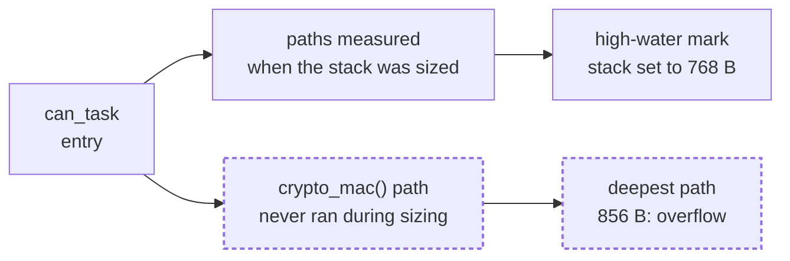
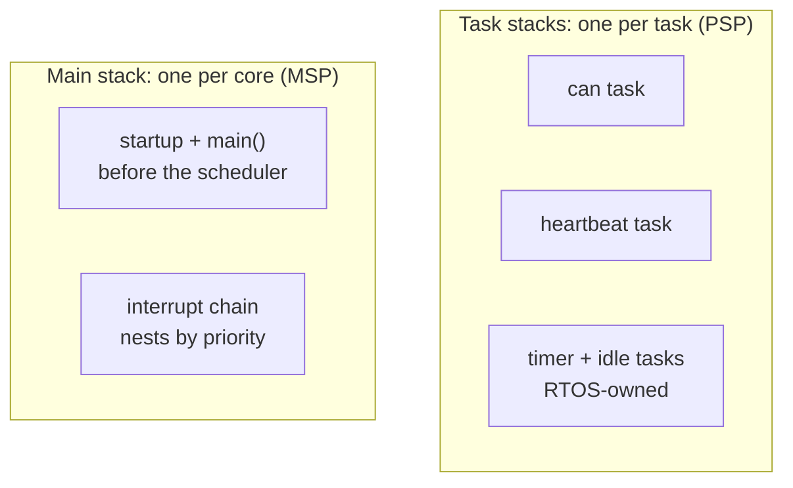
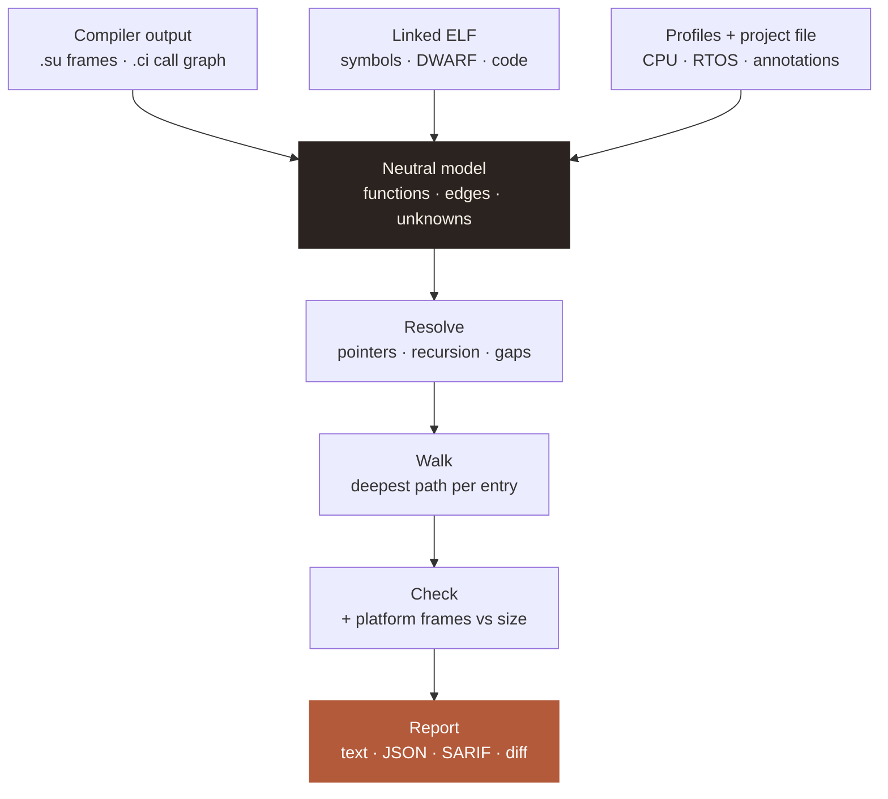
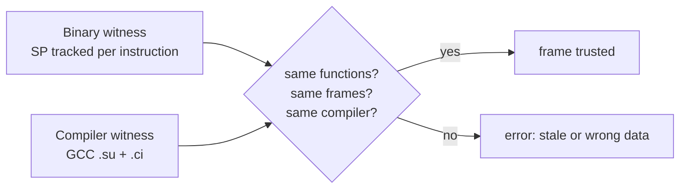
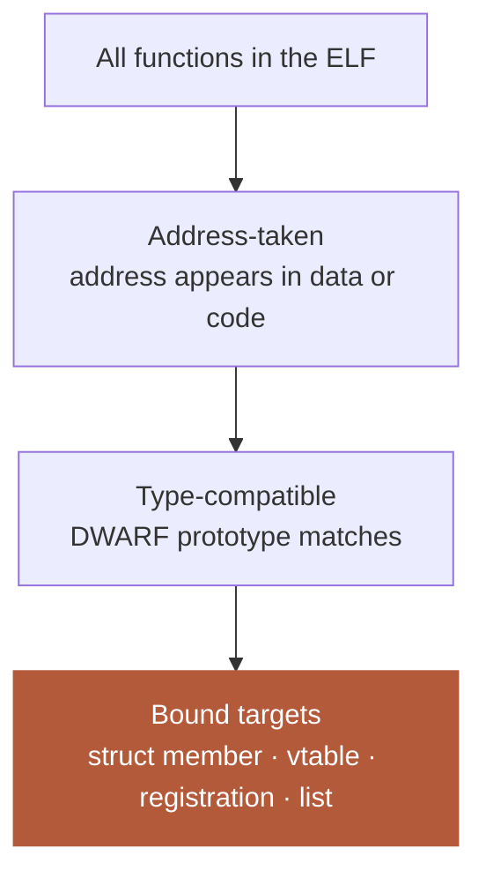
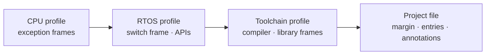

# stack_bound: the idea

**Status:** reviewed · 2026-11-10 · decisions in [ADR-0001](adr/ADR-0001-architecture.md) (accepted)

**Summary.** `stack_bound` computes a safe upper bound for every stack in a firmware image (each
RTOS task, and the interrupt stack of each core) from the build's own output. It shows the deepest
path behind each number, and where it can't prove something it fails or names the assumption.

## 1. The problem: a high-water mark only sees what ran

**Figure 1.** The traveo-body-domain W40 overflow. The dashed path never ran while the stack was
being sized, so the high-water mark couldn't see it. A static walk found 856 B in seconds.

Runtime checks (canaries, RTOS overflow hooks, MPU guards) **detect** an overflow after it happens.
`stack_bound` **prevents** it at build time. Projects keep both.

## 2. What it reports

**Figure 2.** The stacks in an RTOS image. Each one gets its own line in the report.

**Table 1.** Report fields, per stack.

| Field | Meaning |
|---|---|
| required | Deepest path + platform frames (context switch, exceptions) |
| configured | What the build reserves, read from the ELF |
| margin | Share of the configured stack left free |
| recommended | Smallest size meeting the margin rule (default: worst case ≤ 80%) |
| status | `ok` · `FAIL` · `OVERSIZED` |
| worst path | Every function and frame, and how each call was found |
| assumptions | Every annotation, exclusion and profile value used |

A callback is charged to **the stack it runs on**: an interrupt callback to the main stack, a timer
callback to the timer task.

## 3. How it works

**Figure 3.** The pipeline. Everything below the model is toolchain-neutral.

**Table 2.** The four principles.

| Principle | Means |
|---|---|
| The ELF is the referee | Every function comes from the symbol table; unknown = error, never 0 B |
| Two witnesses agree | Binary and compiler data are cross-checked; disagreement fails |
| No silent drops | What it can't see fails the run or becomes a listed assumption |
| Facts in profiles, logic in plugins | New platforms are data; new formats are plugins |

## 4. Two witnesses

**Figure 4.** Changing compiler options is safe: the two witnesses must still agree. Real examples
from Node B are in [How it reads Thumb-2](how-it-reads-thumb2.md).

## 5. Function pointers: the headline feature

**Figure 5.** The funnel. Each step narrows the candidates; the binary sets the outer limit no
annotation can exceed.

**Table 3.** Resolution tiers. Values are followed, so `void *` casts don't break it.

| Tier | Source | Typical case |
|---|---|---|
| 1 Const data | `.rodata` struct members, arrays, vtables | driver tables, virtual calls |
| 2 Initialised data | `.data` initial values in the ELF | generated HAL configs (`.rxCallback`) |
| 3 Value tracking | registration and store sites | `Cy_SysInt_Init(…, isr)`, `xTimerCreate(…, cb)` |
| 4 Type match | DWARF prototypes | leftovers with trustworthy types |
| 5 Address-taken | the binary | last resort for `void *` containers |
| Listed | annotation, checked against tier 5 | what nothing above can express |

Annotations name **a rule** ("whatever is stored in `ipc_port_if_t.transact`"), not a target list,
so a new driver never makes them stale. Every human claim is checked against the binary.

## 6. Hard cases

**Table 4.** How the hard cases are handled.

| Case | Handling |
|---|---|
| Recursion | Cycle found after resolution; needs a depth annotation or fails. Also a MISRA 17.2 check |
| Tail calls | Depth = the larger frame, not the sum |
| Assembly, inline asm | SP tracked through every instruction; SP set from a register fails unless profiled |
| LTO, prebuilt libraries | ELF inventory flags missing data; the binary witness covers it |
| `-fstack-protector` | `__stack_chk_fail` counted at the deepest point |
| Switch tables, returns | `tbb`/`tbh` and `ldr pc, [sp]` recognised, not treated as calls |
| Paths that never run together | Optional exclusions with reasons, all listed |

## 7. Extending it

**Figure 6.** Profiles are TOML data, layered left to right; later layers override. Frontends,
decoders, resolvers and reporters are plugins.

**Table 5.** First support row, and where it extends.

| Axis | First | Next |
|---|---|---|
| Compiler witness | GCC `.su`/`.ci` | Clang, Arm Compiler 6, IAR, GHS |
| Instruction set | Thumb-2 (Cortex-M) | RISC-V, AArch64 |
| Language | C | C++ (vtables, `std::function`) |
| RTOS | FreeRTOS on M4F/M7 | Zephyr, bare-metal |

## 8. Limits and non-goals

**Table 6.** What it doesn't do, stated openly.

| Not | Why / instead |
|---|---|
| A runtime monitor | Keep canaries, overflow hooks, MPU guards as the last line |
| A feasibility prover | Bounds every call-graph path; over-estimates, never under-estimates |
| For stripped or no-`-g` builds | Refused by design |
| Able to resolve truly dynamic addresses | Needs a checked list |
| Independent of profile accuracy | Profiles cite their source and are versioned |

## 9. How it compares

**Table 7.** Neighbouring tools.

| Tool | Function pointers | Gap closed |
|---|---|---|
| `avstack.pl`, puncover | Silently dropped | No silent drops; ELF inventory |
| armlink `--callgraph`, IAR stack usage | Manual control files | Toolchain-neutral; claims checked |
| AbsInt StackAnalyzer | Strong | Open and CI-native; weaker on feasibility |

## Glossary

| Term | Meaning |
|---|---|
| ELF | Linked output: code, data, symbols, DWARF |
| DWARF | Debug info in the ELF (`-g`): source locations, types, call-site values |
| Witness | An independent source of frames and calls |
| Address-taken | A function whose address appears in data or code |
| Tier | One level of function-pointer resolution |
| PSP / MSP | Cortex-M's task and main stack pointers |
| SCC | A group of functions that call each other in a cycle |

**Related:** [ADR-0001](adr/ADR-0001-architecture.md) ·
[requirements](requirements/stack_bound.md) · [How it reads Thumb-2](how-it-reads-thumb2.md) ·
[style guide](style-guide.md)
