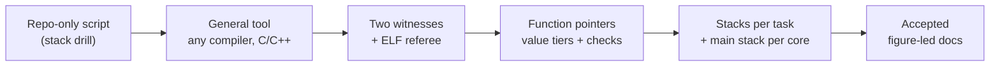

# Review: ADR-0001 stack_bound architecture

**Status:** closed · 2026-11-10 · outcome **accepted** by the owner

**Summary.** The owner reviewed the idea, ADR-0001 and the requirements in a design session with
Claude Code on 2026-11-10, and accepted ADR-0001. The review changed the design in nine places, all
folded in before acceptance. Two items remain open (Table 3).

## 1. Scope

**Table 1.** What was reviewed.

| Document | Version reviewed |
|---|---|
| [idea.md](../idea.md) | figure-led rewrite, `26b2dc5` |
| [ADR-0001](../adr/ADR-0001-architecture.md) | D1–D15, figure-led, `26b2dc5` |
| [requirements](../requirements/stack_bound.md) | `REQ-SB-001…504` (54) |
| [How it reads Thumb-2](../how-it-reads-thumb2.md) | four real Node B sequences |

## 2. What the review changed

**Figure 1.** How the design moved during the review, left to right.

**Table 2.** Review points and outcomes.

| # | Raised by the owner | Outcome |
|---|---|---|
| 1 | Make it a general tool for any embedded platform, of my own design | Neutral core, profiles + plugins (D3, D4); own repository (D15) |
| 2 | Does compiler output change with compiler options? | Two witnesses that must agree (D2); options are free to change |
| 3 | Debug-symbol limits don't matter in development | ELF + DWARF required; no degraded mode (D1) |
| 4 | Function pointers are the key part; make the parser reliable | Tiered resolution, checked annotations, sites from both witnesses (D5, D6) |
| 5 | Runtime-registered callbacks and `void *` casts are common | Value tracking; types only filter (D6, D7) |
| 6 | Support the limits I already designed for | Stack-slot structs, repeat-until-stable, SP tracking, interrupt budget (D7, D9) |
| 7 | Interrupt stack is separate from task stacks | Main stack per core, interrupt chain by priority (D9) |
| 8 | Default margin is 80%, project-specific | `margin_rule = 0.80` default, project override (D10, REQ-SB-301) |
| 9 | Too much text; show it with real Thumb-2 | Figure-led style guide; Thumb-2 walkthrough from the Node B ELF |

## 3. Open after acceptance

**Table 3.** Items still open.

| Item | Where tracked |
|---|---|
| Repeat the GCC spike at `-O2`/`-Os` | ADR-0001 §7 |
| Decide the model and report schemas | ADR-0001 §7 |

**Related:** [ADR-0001](../adr/ADR-0001-architecture.md) · [traceability](../traceability.md)
