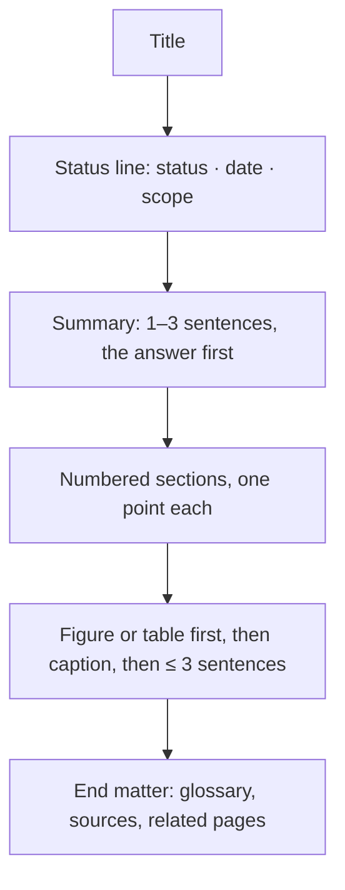

# Document style: figure-led Markdown

**Status:** adopted 2026-11-10 · applies to every page in `docs/`

**Summary.** Each page leads with its answer, and figures carry the argument. Text explains a
figure; it never replaces one. Pages render on GitHub as written and convert to Claude Docs with the
`md-to-claude-doc` skill, without rewriting.

## 1. Page skeleton



**Figure 1.** Every page has the same shape, top to bottom.

## 2. Rules

**Table 1.** Writing rules.

| Rule | Do | Don't |
|---|---|---|
| Lead | First sentence = the point, with its number | "This document describes…" |
| Sections | `## N. Title`, numbered, one point each | Unnumbered walls of headings |
| Figures | A figure for every shape: flow, layers, call chain, state, comparison | A shape described in sentences |
| Captions | `**Figure N.** What it shows.` under every figure; `**Table N.**` above every table | A figure with no caption |
| Prose | ≤ 3 sentences per paragraph, < 25 words per sentence | Paragraphs that restate the figure |
| Numbers | Units always: `136 B`, `384 words`, `80%` | "large", "small", "a lot" |
| Code | Fenced with a language: `armasm`, `c`, `toml`, `python` | Unfenced or unlabelled code |
| Callouts | `> **Note.**` or `> **Limit.**` blockquote, one line | GitHub `[!NOTE]` alerts (they don't convert) |
| Emphasis | Bold only in labels, captions and table headers | Bold in the middle of sentences |

## 3. Choosing the figure

**Table 2.** Which figure fits which content.

| Content has… | Use | Mermaid type |
|---|---|---|
| Steps that branch or loop, data flow | Flowchart | `flowchart LR` (few, wide) or `TB` (deep) |
| Parts inside parts | Grouped flowchart | `flowchart` with `subgraph` |
| A conversation over time (caller → callee) | Sequence | `sequenceDiagram` |
| States and transitions | State diagram | `stateDiagram-v2` |
| Items × attributes | Table | (pipe table) |
| Instructions to explain | Code block + step table | ` ```armasm ` + a table with one row per step |

Keep a figure to **≤ 12 nodes**. Split a bigger one into an overview and a detail figure.

**Table 3.** Box emphasis. Boxes are cream with rust borders by default; mark at most two per figure.

| Class | Looks | Use for | Markdown |
|---|---|---|---|
| (none) | cream fill, rust border | every ordinary box | — |
| `key` | dark brown fill, light text | the central idea the figure is about | `class MOD key` |
| `hot` | terracotta fill, white text | the result or the thing to notice | `class O hot` |

Copy both definitions into the figure so it looks the same on GitHub and in Claude Docs; the HTML
renderer swaps in its own light or dark colours:

```text
classDef key fill:#2b2320,stroke:#2b2320,color:#f6efe6
classDef hot fill:#b35a3a,stroke:#b35a3a,color:#ffffff
```

Any other `classDef` must carry a meaning that the caption explains (for example a dashed path).

## 4. Code walkthroughs

A walkthrough is a code block, then a table that reads it, one row per step. Addresses and
instructions come from a real build, never made up.

```armasm
10086742  stmdb  sp!, {r4-r9, sl, fp, lr}   @ 9 registers → 36 B
10086746  sub    sp, #100                    @ locals → 136 B
```

**Table 4.** Example step table.

| Step | Instruction | What the tool learns |
|---|---|---|
| 1 | `stmdb sp!, {…9 regs}` | SP depth 36 B |
| 2 | `sub sp, #100` | SP depth 136 B, the frame |

## 5. Converting to Claude Docs

The `md-to-claude-doc` skill maps each element one to one. Mermaid blocks, pipe tables and code
blocks carry over unchanged. Captions become the line under each exhibit, and the status line
becomes the doc's byline. Anything outside this guide is flagged during conversion, never dropped.
